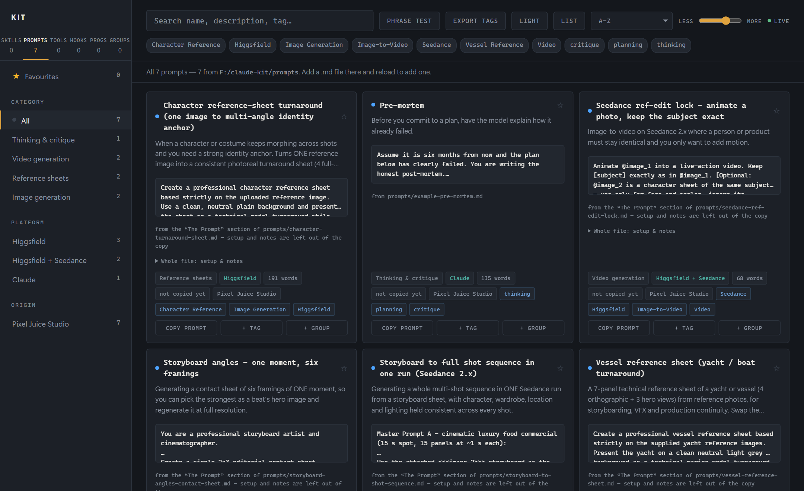

# Kit

**What you have in Claude Code, and whether you can reach it.**

A skill file sitting in a folder is not a skill Claude can use. It may belong to
a plugin that is not enabled, be set to Manual so it never fires on its own, or
be shadowed by another with the same name. Kit shows you the difference:
**every skill, prompt, hook and tool you have, whether a session can actually
reach it, and when it last fired.**

It is a small local web page for people who have collected a lot of Claude
Code skills, prompts, hooks and scripts and have lost track of them. It scans
your `~/.claude` folder (and, optionally, a folder of your own tools), shows
everything on one searchable page, and answers the questions a plain file
listing cannot: *will this skill actually fire? is that hook registered or just
sitting on disk? where is the prompt I wrote last month?* It runs on your
machine, reads only local files, and needs nothing but Python.



## Quick start (about a minute)

```sh
git clone https://github.com/pixeljuicestudio/claude-kit.git
cd claude-kit
python serve.py
```

Your browser opens at **http://127.0.0.1:8712/** showing what Claude Code has
on this machine. Leave the terminal running while you use the page; Ctrl-C
stops it. On Windows you can double-click `SKILLS.bat`; on macOS/Linux,
`./kit.sh`.

New to skills, or the Skills tab is empty? Copy the example in and reload:

```sh
cp -r examples/skills/hello-kit ~/.claude/skills/
```

It appears as **Auto**: Claude will load it whenever you ask "is Kit
working?". Flip it to Manual on its card and it only runs as `/hello-kit`.

**What Kit is not:** an agent framework. It does not make Claude write better
code; it shows you what your setup actually gives Claude, so you can fix it.

## The five tabs

Each answers a different question and none can answer another's:

| Tab | The question it answers |
|---|---|
| **Skills** | which skills can a session actually reach, and which will auto-fire? |
| **Prompts** | what is this prompt for, and give me the text |
| **Tools** | what tools have I got, and how do I start each one? |
| **Hooks** | what is wired to fire, and on which event? |
| **Progs** | what Python is here, what does it do, have I run it? |

Made by [Pixel Juice Studio](https://github.com/pixeljuicestudio) ·
[github.com/pixeljuicestudio/claude-kit](https://github.com/pixeljuicestudio/claude-kit)

## Requirements

- Python 3.10 or newer. **Standard library only** - nothing to `pip install`.
- Claude Code, so there is a `~/.claude` folder to read.
- Optional: Node.js, only to run `test_render.py`.
- Optional: Pillow, only to redraw the icon with `icon.py`.

Works on Windows, macOS and Linux. A few Tools-tab facets (desktop shortcuts,
Task Scheduler) are Windows facts and read *n/a* elsewhere.

## Running options

- `python serve.py --port 8800` (or `KIT_PORT=8800`) for another port.
- `python serve.py --no-browser` to not open a tab.

The server listens on 127.0.0.1 only. Opening `skills.html` straight from disk
(`python build.py` writes one) gives a read-only copy: everything renders, but
stars, tags and toggles need the server and say so.

## Configuration

Kit works with no configuration at all. To go further, copy
`kit.config.example.json` to `kit.config.json` (gitignored) and keep only the
keys you need:

| Key | Default | What it does |
|---|---|---|
| `tools_root` | none | Folder whose subfolders are your tools. Without it, the Tools tab shows setup instructions and Progs lists hooks only. |
| `project_settings` | `[]` | Extra `settings.json` files whose hooks to list (project-scope hooks). |
| `extra_skill_dirs` | `[]` | Extra folders of `<name>/SKILL.md` to inventory (a skills repo you upload to claude.ai, a project's `.claude/skills`). |
| `prompts_dir` | `prompts/` | Where your prompt files live. |
| `runs_dir` | `.runs/` | Where launcher activity markers go (see `mark_launchers.py`). |
| `transcripts_project` | derived | The `~/.claude/projects/<name>` folder `replay.py` and `guard.py` read. Default: the one with the most transcripts. |
| `reference_dir` | none | Folder of downloaded reference videos named `... [<post id>].mp4`, matched to a prompt's `url`. |
| `mode_sync_script` | none | Script run with `--fix-modes --quiet` after an Auto/Manual toggle, to sync an external skills index. |
| `port` | `8712` | Server port (`KIT_PORT` and `--port` win). |
| `notion.db_id` | none | Optional Notion prompt database, see below. |

`python config.py` prints the resolved configuration.

## Adding a prompt

Drop a Markdown file into `prompts/` and reload the page:

```markdown
---
name: Pre-mortem
tags: [thinking, planning]
platform: Claude
for: Before you commit to a plan, find out how it fails.
origin: Written in-house
url: https://example.com/where-it-came-from
---
Assume it is six months from now and this plan has failed...
```

Everything below the frontmatter is what **Copy prompt** copies. If the body
has a `## The Prompt` (or `## The template`) section, only that section is
copied; setup text above it and `## Notes` below it stay readable on the card
but out of the clipboard. The category comes from your tags (Thinking &
critique, Video generation, Reference sheets, Image generation, Coding,
Writing, Research, System & ops; else Unsorted). Full format:
[prompts/README.md](prompts/README.md).

The repo ships a few example prompts. Point `prompts_dir` at a private folder
to keep your own library out of this repo.

## Adding a skill

Kit does not install skills; it shows the ones Claude Code already has:

- `~/.claude/skills/<name>/SKILL.md` - your own skills ("This PC").
- `~/.claude/plugins/cache/...` - installed plugins, reachable only if enabled
  in `settings.json` (`enabledPlugins`).
- `~/.claude/plugins/marketplaces/...` - the catalogue you could install.
- every folder in `extra_skill_dirs`.

Create a skill the normal way (a folder with a `SKILL.md` that has `name` and
`description` frontmatter) and reload. Plugin upstreams are read from
`~/.claude/plugins/known_marketplaces.json`.

## The Tools roster

Tools is the only tab whose membership is a decision rather than a rule. The
other four have one: a `SKILL.md` exists, a prompt file exists, a `.py` sits one
level in, `settings.json` registers it. "Is this folder a tool?" has no such
rule - a README, a git repo and "documented somewhere" all give different
answers. So you tick them by hand:

1. Set `tools_root` in `kit.config.json`.
2. Copy `tools.example.json` to `tools.json` and list the folders worth finding
   again under `roster`, and the ones you looked at and rejected under
   `not_tools`.

Because hand-maintained lists drift, every folder under `tools_root` that is
neither rostered nor rejected is counted and shown as **unlisted**, so a new
tool cannot hide. Everything else on a tool card is measured, never typed: the
description is the first real sentence of its README, "how you start it" is
derived from launchers, desktop shortcuts and scheduled tasks, git state comes
from `.git`. A tool with exactly one `.bat`/`.cmd`/`.exe` launcher gets a
**Launch** button; an ambiguous one gets none, because a wrong button is worse
than no button.

Optional `connect` entries in `tools.json` (`{"tcp": port}` or
`{"process": "App.exe"}`) let a tool show **connected**, a step past "a process
exists" - useful for MCP bridges that every Claude Code session spawns whether
or not the app behind them is open.

## The three states

| State | Description in context | Fires on your phrasing | How you reach it | Cost |
|---|---|---|---|---|
| **Auto** (blue) | yes | **yes** | just talk | ~description length / 4 tokens, every session |
| **Manual** (yellow) | no | no | `/name` | ~0 |
| **Off** (red) | no | no | paste its path | 0 |

Manual is the frontmatter flag `disable-model-invocation: true`. Click the
toggle on a card to switch (the server re-reads the file before reporting
success), or from a terminal: `python mode.py list / manual <name> / auto <name>`.

It blocks Claude from invoking the skill *at all*, not just from auto-firing,
so a skill that another skill routes to (`parent-child` naming) breaks if set
Manual. Those show as **locked auto** and `mode.py` refuses them without
`--force`. Extra-folder skills and anything Off have a disabled toggle with the
reason in its tooltip, rather than a toggle that silently does nothing.

**Location** and **Origin** are separate filters. Where a file lives says
nothing about whether it fires, and a `LICENSE` naming someone else marks a
skill as **Borrowed**: a copied skill gets no upstream updates and its
description was written for someone else's phrasing.

## Live

The lamp in the header. While the server runs it tails
`~/.claude/projects/*.jsonl` and lights the matching card for a minute when a
skill fires or a program runs.

**What it cannot see**, said plainly because a light that means less than it
looks like is worse than no light:

- **Programs** only when run *through Claude Code*, and only Python. A `.bat`,
  a desktop icon, a terminal or a scheduler writes nothing a transcript can be
  read for. (`mark_launchers.py` can add a one-line marker to your `.bat`
  launchers so starting a tool by icon lights it too.)
- **Tools** have no event of their own; a tool lights when a program inside it
  runs. If a program name exists in several tool folders and the transcript
  carries no path, it lights **nothing** rather than guessing.
- **Hooks**, deliberately. The harness records only Stop hooks, which fire on
  every turn, so a light would mean "this is a Stop hook", not "this just did
  something". Hook runs are filtered out of the feed by registration.
- **Prompts** light on *copy*, from the click itself.

Two design points: **history is not activity** - the first poll records where
every file ends and reports nothing, or opening Kit would light everything you
have ever used. And the tail runs on the **server's clock**, not the browser's,
so coming back to a hidden tab does not replay ten minutes of events as "now".

Separately, **Running** shows which tools have a live process right now (a
state, not an event), by matching process command lines to tool folders.

## Categories

Skills are sorted into eight categories by keyword, marked with a `?` because
it is a guess - a wrong category that looks authoritative is worse than a
visible **Unsorted**. Family modules inherit their parent's category, and
keywords match on a word boundary (otherwise `tts` matches inside "Fitts's
Law"). If you keep a hand-labelled skills index, export it as
`notion_rows.json` (`[{"name", "home", "category", "status"}]`) and those labels
win; the sidebar's **Notion reconcile** view then lists skills with no row and rows
with no file, matched exactly, never by substring.

Prompt categories are a lookup from your tags, never a guess, so they carry no
`?`.

## Stars, tags and groups

Every card has a star, and **+ Tag** / **+ Group** buttons. They are saved by
the server to small JSON files beside the code (`favourites.json`,
`prompt_favourites.json`, `tags.json`, `groups.json`, ...), not to the browser,
so they survive a browser wipe. Each write is re-read before the star turns
gold. All of these are gitignored and created on first use. Groups are the one
list that mixes kinds: a shortlist of skills, prompts and tools for one job.

## Optional: Notion prompts

If you keep prompts in a Notion database, Kit can show them beside your local
files:

1. Create a Notion integration, share the database with it, and export its
   token as `NOTION_TOKEN` in the environment that runs `serve.py`. The token
   is read **only** from the environment, never from a file.
2. Set `"notion": {"db_id": "<database id>"}` in `kit.config.json`.

Expected properties: `Name` (title), `Tags` (multi-select), `For`, `Origin`
(text), `Reference` (url). The prompt is taken from the page's `## The Prompt`
section, a `Prompt:` paragraph, or the whole page. The server pulls once at
startup into `prompts.json` (gitignored) and a **Refresh from Notion** button
appears; `python prompts.py --export` does the same. A local file wins over a
Notion row with the same name. Without both settings, nothing touches the
network.

## Safety

Read-only against your skills apart from one change: the Auto/Manual flag in a
`SKILL.md` under `~/.claude/skills`. Kit never moves a folder or writes
`settings.json`. The server binds to 127.0.0.1 and answers only its own page
(other websites open in your browser are refused); every write endpoint
validates the name against the scanned inventory; **Launch** and **open
reference** take a *name* from the page and resolve the path server-side, never
a path from the request, and re-check that it is inside the configured folder.
Full detail, and how to report a problem: [SECURITY.md](SECURITY.md).

## Command-line tools

    serve.py            the server (the page)
    build.py            write a static, read-only skills.html
    scan.py             skill inventory + reach + health flags
    prompts.py          prompt library (local files + optional Notion)
    tools.py            the tool roster + the drift valve
    hooks.py            what settings.json registers, reconciled against disk
    programs.py         runnable Python in your tools + hooks
    usage.py            how often each skill fired (mined from transcripts)
    mode.py             Auto / Manual from a terminal
    replay.py           score real prompts against skill descriptions to find misses
    guard.py            snapshot which prompts each skill wins, diff after an edit
    born.py             when each skill first appeared (feeds replay.py)
    running.py          which tools have a live process
    mark_launchers.py   add activity markers to .bat launchers (Windows)
    config.py           resolved configuration
    icon.py             redraw kit.ico (needs Pillow)

## Tests

Each `test_*.py` is a standalone script: `python test_scan.py` exits 0 when
every invariant holds. Run them all:

```sh
for t in test_*.py; do python "$t" || echo "FAILED: $t"; done
```

The tools and running suites build their own temporary fixtures, so they pass
on a fresh machine. `test_hooks.py` and `test_render.py` check a real install:
they need at least one registered hook and one skill. `test_security.py`
starts a throwaway server and checks it refuses other websites. `test_render.py`
needs Node: it runs the page's emitted JavaScript against a DOM stub and calls
every draw function on every sort option, because `node --check` and the
Python suites are both blind to a runtime `ReferenceError` - one once left the
Tools tab silently showing the previous tab's list behind four green checks.

## License

MIT - see [LICENSE](LICENSE).
